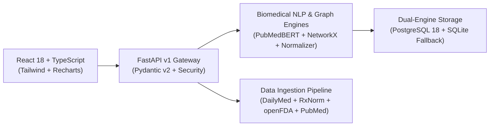

# PharmaMind AI 🧬💊

> **Sophisticated, Evidence-Grounded Biomedical Drug-Information Intelligence Platform**

PharmaMind AI combines **Biomedical Natural Language Processing**, **Transformer Encoders (PubMedBERT)**, **Biomedical Knowledge Graphs**, **Graph Machine Learning**, and **Retrieval-Augmented Generation (RAG)** with strict clinical provenance tracking.

---

## 🌟 Key Capabilities

- **Authoritative Drug Monographs**: Verified FDA DailyMed structured labeling and NLM RxNorm standardized nomenclature.
- **Drug-Drug Interaction (DDI) Intelligence**: Multi-drug clinical risk assessment showing pharmacodynamics, CYP450 metabolism competitions, and explicit uncertainty statements.
- **Multi-Source Data Ingestion & Quality Audit**: Integrated pipeline coordinating DailyMed, RxNorm, openFDA, and PubMed with automated deduplication and completeness scoring.
- **Biomedical Drug Normalizer**: Strips dosage forms, strength units, and pharmaceutical salts; maps trade brands to generic entities; recovers from spelling variations via Levenshtein edit distance.
- **Biomedical Named Entity Recognition (NER)**: Extracts 8 distinct biomedical categories (Drugs, Ingredients, Diseases, Symptoms, Proteins/Targets, Pathways, Adverse Effects, Drug Classes) with character offsets and ontological IDs (RxNorm, MeSH, HGNC, Reactome, MedDRA, ATC).
- **Post-Marketing Safety Signals**: Surfaces FAERS adverse event counts with mandatory epidemiological non-causality guardrails (`is_causal_confirmed = False`).
- **Biomedical Knowledge Graph**: Multi-relational heterogeneous graph connecting drugs, active ingredients, biological targets (e.g. VKORC1, COX-1, HMGCR), disease indications, and adverse effects.
- **Empirical AI Benchmarking Dashboard**: Transparent evaluation tracking NER Precision/Recall/F1, Retrieval Recall@K/MRR/NDCG, Graph ML AUROC/AUPRC, and RAG Faithfulness.
- **Deterministic Refusal Guardrails**: Automatically rejects personalized diagnosis, prescribing, or dosage alteration requests with clinical advisory notices.

---

## 🏛️ System Architecture



---

## 💻 Hardware Constraints & Windows 16GB RAM Optimization

PharmaMind AI is engineered specifically for Windows development environments with **16 GB RAM** and **CPU execution**:
- **PyTorch CPU Constraints**: `torch.set_num_threads(4)` prevents CPU starvation.
- **Lazy Model Loading**: Transformer checkpoints load on explicit invocation, avoiding memory bloat at boot.
- **Memory Safety Guard**: Pauses heavy inference if host free RAM drops below 1,024 MB.
- **Dual-Engine DB Resilience**: Automatically connects to native PostgreSQL 18 or gracefully falls back to local SQLite without crashing.

---

## 🚀 Quickstart Guide

### 1. Backend Setup
```bash
# Navigate to backend
cd backend

# Install dependencies
pip install -r requirements.txt

# Run automated unit and integration tests (107 tests passing)
python run_tests.py

# Start FastAPI development server
python -m uvicorn app.main:app --host 127.0.0.1 --port 8000 --reload
```
API Documentation will be available at:
- Swagger UI: `http://127.0.0.1:8000/api/v1/docs`
- Health Telemetry: `http://127.0.0.1:8000/api/v1/health`

### 2. Frontend Setup
```bash
# Navigate to frontend
cd frontend

# Install packages
pnpm install

# Start Vite development server
pnpm run dev
```
Frontend Web Application will be available at `http://127.0.0.1:5173`.

### 3. Docker Compose (Full Stack)
```bash
docker compose up --build
```

---

## 🧪 Automated Test Suite

Run the full suite of unit, database, normalization, NER, embeddings, and semantic retrieval tests:
```bash
python backend/run_tests.py
```
**Current Status: 107 / 107 Tests Passing (100% Success Rate in ~9.5s)**
- **Configuration & Hardware Constraints**: 4 tests OK
- **Database & Schema Integrity**: 4 tests OK (15 registered models)
- **FDA DailyMed Client**: 4 tests OK (SPL sections, boxed warnings, contraindications)
- **NLM RxNorm Client**: 6 tests OK (RxCUI mapping, approximate typo matching, brand names)
- **openFDA & FAERS Signals**: 4 tests OK (labeling, causality disclaimers, MedDRA signals)
- **NCBI PubMed Literature**: 3 tests OK (E-utilities search, MeSH terms, article details)
- **Drug Normalization Engine**: 7 tests OK (salt stripping, brand mapping, Levenshtein distance, typo recovery)
- **Biomedical NER Extractor**: 5 tests OK (8-category extraction, character offsets, non-overlapping spans)
- **Biomedical Embeddings Service**: 5 tests OK (384D shape, L2 normalization, semantic relatedness contrast)
- **Vector Storage Engines (NumPy & FAISS)**: 5 tests OK (exact cosine Top-K, metadata filters, factory)
- **Hybrid Search Engine & Okapi BM25**: 3 tests OK (BM25 scoring, fused linear scoring, filtered retrieval)
- **Biomedical Transformer Benchmark**: 3 tests OK (CPU thread capping, model cards, ClinicalBERT boundary)
- **Biomedical Knowledge Graph Engine**: 6 tests OK (multi-relational NetworkX, neighborhood subgraphs, multi-hop shortest paths)
- **Node2Vec Graph Embedder**: 3 tests OK (biased random walks, SPPMI SVD, L2 normalization, reproducibility)
- **Graph ML Link Predictor**: 3 tests OK (calibrated edge classifier, AUROC >= 0.80, mandatory experimental disclaimer)
- **Retrieval-Augmented Generation (RAG)**: 6 tests OK (monograph synthesis, citations, hallucination detection, prescribing refusal, uncertainty handling)
- **Drug Interaction Intelligence**: 6 tests OK (brand resolution, clinical synergy, uncertainty statements, experimental predictions, multi-drug combinations)
- **Empirical AI Evaluator Service**: 5 tests OK (NLP precision/recall/F1, search Recall@5/MRR/NDCG, Graph ML, RAG faithfulness)
- **API Endpoints & Refusal Guardrails**: 5 tests OK (prescribing refusal, literature, evaluation transparency)
- **Data Ingestion Pipeline**: 6 tests OK (monograph ingestion, deduplication, quality reports, FAERS signals)
- **Search Endpoints**: 6 tests OK (dense semantic search, hybrid retrieval, embedding preview, model cards)
- **Knowledge Graph Endpoints**: 7 tests OK (full graph, neighborhood subgraphs, multi-hop paths, experimental predictions, ML benchmarks)

---

## 🎨 Frontend Production Build

The React 18 + TypeScript + Tailwind CSS application compiles with zero errors:
```bash
cd frontend
pnpm run build
# Output: dist/index.html (1.16 kB), dist/assets/index.js (641 kB), dist/assets/index.css (32 kB)
```

---

## 📚 Technical Documentation

- [Architecture Design](docs/ARCHITECTURE.md)
- [Architecture Decision Records (ADRs)](docs/DECISIONS.md) (ADR-001 through ADR-013)
- [Biomedical Data Sources & Provenance](docs/DATA_SOURCES.md)
- [Machine Learning Models & Methodology](docs/ML_MODELS.md)
- [Known Limitations](docs/KNOWN_LIMITATIONS.md)
- [Clinical Safety & Non-Prescribing Policy](docs/SAFETY.md)
- [Evaluation & Benchmarking Methodology](docs/EVALUATION.md)
