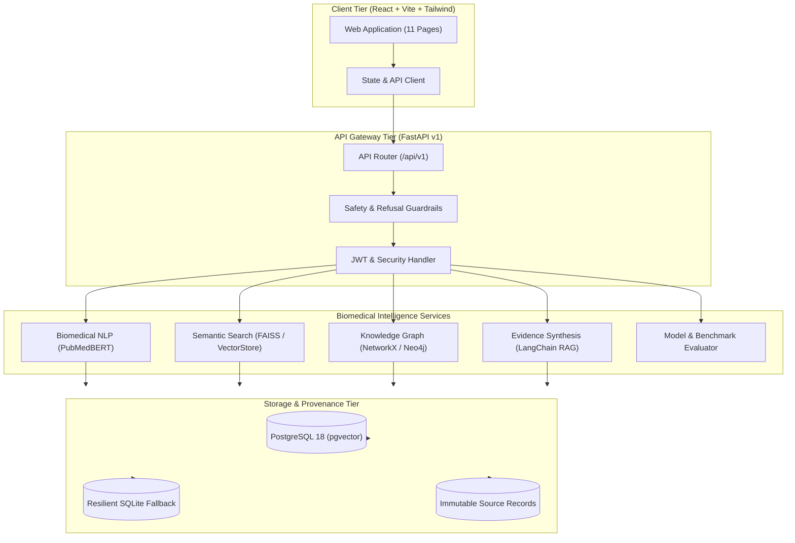

# PharmaMind AI - System Architecture



---

## 1. Architectural Philosophy

PharmaMind AI is architected as an **evidence-grounded pharmaceutical intelligence platform**. Unlike generic chat interfaces that improvise medical statements, PharmaMind AI enforces strict **clinical provenance**:

1. **Deterministic Guardrails**: Prohibits personal diagnoses, prescribing instructions, or dosage calculations before queries enter the LLM or retrieval pipeline.
2. **Four-Tier Evidence Classification**:
   - **Tier 1 (Authoritative)**: FDA DailyMed labeling & NLM RxNorm.
   - **Tier 2 (Scientific Literature)**: Peer-reviewed PubMed & PMC research.
   - **Tier 3 (Experimental ML)**: Graph Machine Learning link predictions (Node2Vec, GraphSAGE).
   - **Tier 4 (Signals & Uncertainty)**: FAERS post-marketing signals (clearly labeled as unconfirmed causality).
3. **Hardware Constraint Awareness**: CPU inference thread limits (`torch.set_num_threads(4)`), lazy model loading, and memory safety checks to respect a 16 GB host RAM footprint.

---

## 2. Directory Hierarchy

```
pharmamind/
├── backend/
│   ├── app/
│   │   ├── api/v1/endpoints/   # Modular domain endpoints (health, drugs, interactions, graph, etc.)
│   │   ├── core/               # Configuration, security, exceptions, and logging
│   │   ├── database/           # SQLAlchemy session, engine resilience, declarative base
│   │   ├── models/             # 15 domain data models across drugs, graph, literature, and evaluation
│   │   ├── schemas/            # Pydantic v2 validation contracts
│   │   ├── repositories/       # Data access interfaces (drugs, graph, literature)
│   │   ├── services/           # Business logic (biomedical_nlp, rag, graph_ml, interactions)
│   │   ├── integrations/       # External wrappers (transformers, llm, data_sources)
│   │   └── main.py             # FastAPI entrypoint with lifespan startup/shutdown
│   ├── tests/
│   │   ├── unit/               # Unit tests (config, models, database)
│   │   ├── integration/        # Route integration tests & safety guardrail verification
│   │   └── evaluation/         # Benchmarking dataset tests
│   ├── run_tests.py            # Unified automated test runner
│   └── requirements.txt        # Production backend dependencies
├── frontend/
│   ├── src/
│   │   ├── components/         # Navbar, Sidebar, SafetyBanner, UI primitives
│   │   ├── pages/              # 11 production healthcare pages
│   │   ├── services/           # Typed backend API client with resilient fallbacks
│   │   ├── types/              # Comprehensive TypeScript interfaces
│   │   ├── App.tsx             # Master navigation and state coordinator
│   │   └── main.tsx            # React 18 DOM mount point
│   ├── package.json
│   ├── vite.config.ts
│   └── tailwind.config.js
├── docs/                       # Architectural and engineering documentation
├── docker-compose.yml          # Multi-container orchestration (PostgreSQL 18, backend, frontend)
├── Dockerfile.backend
└── Dockerfile.frontend
```

---

## 3. Data Flow & Provenance Architecture

When a biomedical inquiry is processed:
1. **Query Normalization**: Raw drug names or brand names are resolved to canonical generic names and RxNorm CUIs via `DrugSynonym` lookup.
2. **Safety Intent Check**: If the query asks for personalized prescribing or diagnosis, an immediate `MedicalAdviceProhibitedException` is raised.
3. **Multi-Source Evidence Retrieval**:
   - Regulatory monograph retrieved from FDA DailyMed records.
   - Known interaction records queried from `DrugRelationship` table with confidence scores.
   - Knowledge graph traversed for biological targets (e.g. VKORC1, COX-1, HMGCR) and adverse effects.
4. **Structured Evidence Formatting**: Response is returned with:
   - `direct_explanation`
   - `drug_information`
   - `evidence_summary`
   - `citations` (with verifiable URLs and PMIDs)
   - `confidence_status`
   - `safety_disclaimer`

